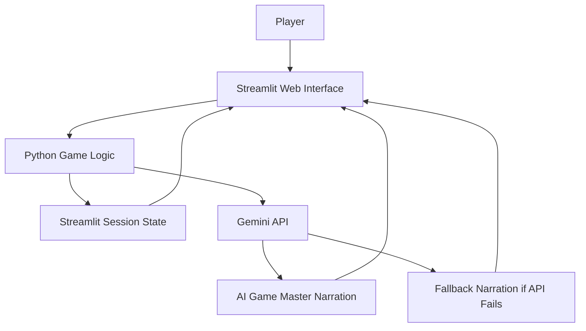

# Version 1 Architecture — The Mysterious Library

## Component Description

- Player: Enters natural-language actions.
- Streamlit: Displays the game interface.
- Python Game Logic: Validates puzzle solutions and controls game rules.
- Session State: Stores inventory, action history, and escape progress.
- Gemini API: Attempts to generate atmospheric Game Master narration.
- Fallback Narration: Keeps the game playable if Gemini is unavailable.
