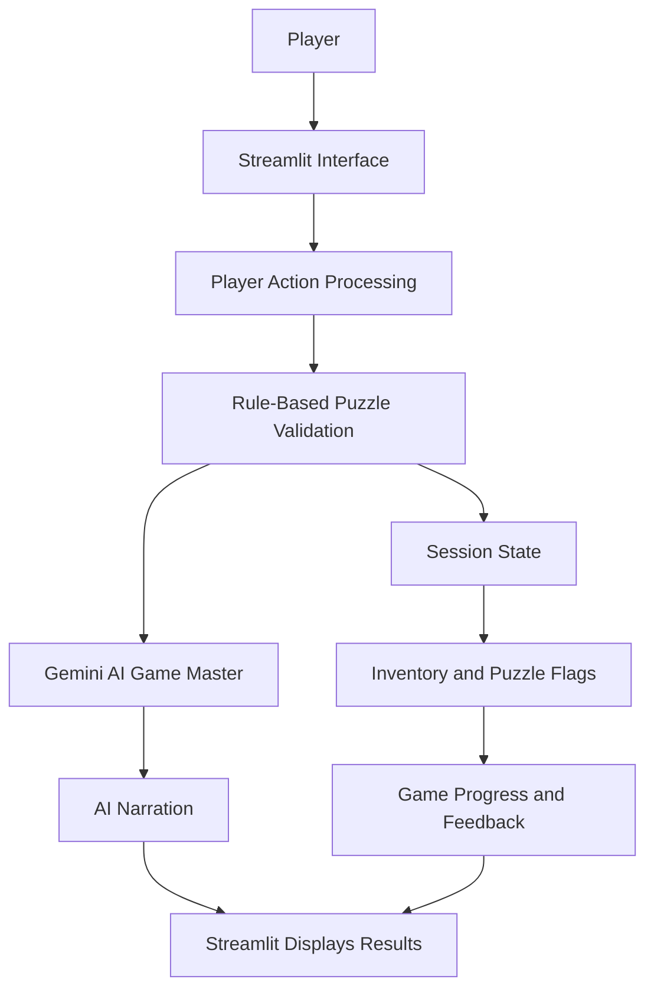

# Version 2 Architecture — AI Escape Room

## Overview

Version 2 improves the original AI Escape Room by
introducing structured puzzle state and stronger
validation of player actions.


## Architecture Diagram




## Main Components

1. **Player:** Enters natural-language commands.

2. **Streamlit Interface:** Displays the game,
   inventory, conversation history, and progress.

3. **Player Action Processing:** Identifies which
   object the player wants to interact with.

4. **Puzzle Validation:** Checks whether the player
   has the required key, password, and discovered clues.

5. **Session State:** Stores inventory, conversation
   history, escape status, and puzzle flags.

6. **Gemini AI Game Master:** Generates narrative
   responses to player actions.

## Improvements Over Version 1

- Tracks whether the drawer puzzle has been solved.
- Tracks whether the painting clue has been discovered.
- Prevents escaping by guessing the password before
  examining the painting.
- Resets puzzle state when the game restarts.
- Preserves conversation history during gameplay.
```


